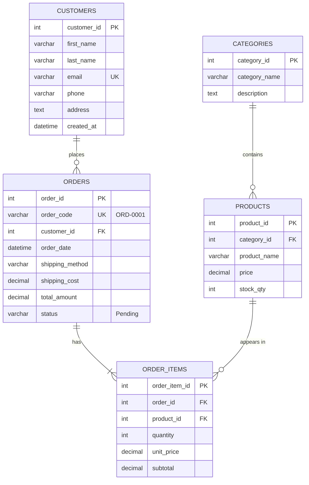

# E-Commerce Order Database – ERD

## Relationships

| Relationship | Type | Explanation |
|---|---|---|
| Customers → Orders | 1 : N | One customer can place many orders; each order belongs to one customer. |
| Categories → Products | 1 : N | One category contains many products; each product belongs to one category. |
| Orders → Order_Items | 1 : N | One order has one or more order items. |
| Products → Order_Items | 1 : N | One product can appear in many order items. |
| Orders ↔ Products | M : N | Resolved through the **Order_Items** junction table. |

See [schema.sql](schema.sql) for the SQL implementation.
